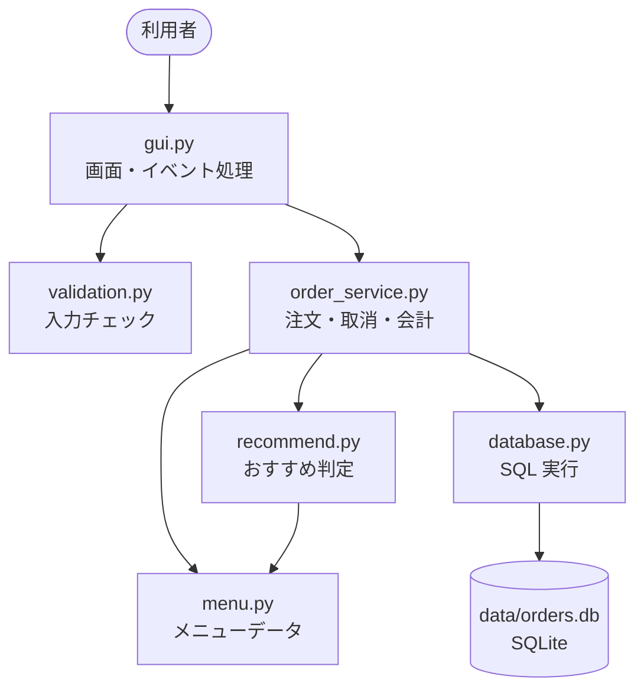
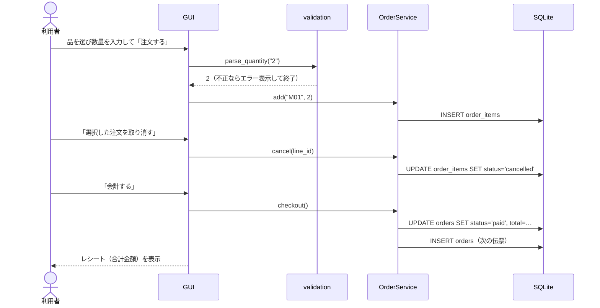
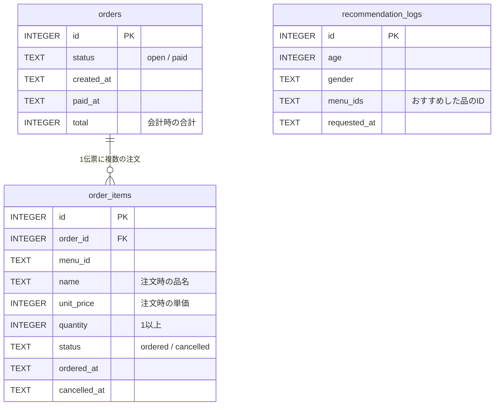

# 洋食ダイニング こうべ亭 — メニュー・オーダーシステム

飲食店向けのメニュー表示・注文・会計デスクトップアプリです。
Python の標準ライブラリ（tkinter / sqlite3）だけで動き、**追加のインストールは不要**です。


---

## 1. 起動方法

### 動作環境

| 項目 | 内容 |
|---|---|
| Python | 3.9 以上（3.14 で動作確認済み） |
| OS | Windows / macOS / Linux |
| 外部ライブラリ | なし（tkinter, sqlite3 は Python に同梱） |

### 手順

```bash
git clone <このリポジトリのURL>
cd restaurant-order-system
python main.py
```

- macOS / Linux で `python` が無い場合は `python3 main.py` を使ってください。
- Linux で `No module named '_tkinter'` と出る場合は tkinter を追加してください（例: `sudo apt install python3-tk`）。
- 初回起動時に `data/orders.db`（注文データ）が自動で作られます。初期化したいときはこのファイルを削除してください。

### テストの実行（任意）

```bash
python -m unittest -v
```

---

## 2. 使い方と要件の対応

| # | 要件 | 画面での確認方法 | 実装箇所 |
|---|---|---|---|
| 1 | 店名表示 | 起動すると画面上部とタイトルバーに「洋食ダイニング こうべ亭」と表示されます。 | `config.py` / `gui.py` |
| 2 | メニュー表示（20品以上・カテゴリ切替・適正価格） | 全27品（前菜6・メイン8・ドリンク8・デザート5）。上部の「すべて／前菜／メイン／ドリンク／デザート」ボタンで切り替えます。価格は税込です。 | `menu.py` |
| 3 | 注文（数量指定・会計前の取消） | 品を選び、数量（1〜99）を入れて「注文する」。右側の注文一覧で行を選び（Ctrl/Shift で複数可）「選択した注文を取り消す」。 | `order_service.py` |
| 4 | 注文データの記録 | 注文・取消・会計はすべて SQLite（`data/orders.db`）に記録されます。取り消した注文も削除せず「取消」状態で残ります。「会計履歴」ボタンで会計済みの伝票を一覧できます。 | `database.py` |
| 5 | おすすめ機能 | 「おすすめ診断」に年齢と性別を入れて「おすすめを見る」。カテゴリごとに1品ずつ理由付きで表示され、そのまま注文できます。 | `recommend.py` |
| 6 | 会計 | 「会計する」を押すと明細と合計金額（税込）のレシートが表示されます。会計後は新しい伝票に切り替わります。 | `gui.py` `ReceiptWindow` |
| 7 | 入力チェック | 年齢に `abc`、`-5`、`3.5`、空欄、`200` などを入れても止まらず、赤字でエラー内容を表示します。全角数字（`３５`）は受け付けます。数量も同様にチェックします。 | `validation.py` |

---

## 3. システム構成

### ディレクトリ構成

```
restaurant-order-system/
├── main.py                  # 起動スクリプト（DB接続 → 画面起動）
├── restaurant/
│   ├── config.py            # 店名・DBパス・入力範囲などの設定値
│   ├── menu.py              # メニューデータ（27品）と検索関数
│   ├── validation.py        # 年齢・数量の入力チェック
│   ├── recommend.py         # おすすめロジック
│   ├── database.py          # SQLite のテーブル定義と読み書き
│   ├── order_service.py     # 注文・取消・会計の業務ロジック
│   └── gui.py               # tkinter の画面
├── tests/                   # unittest による自動テスト
├── data/                    # orders.db が自動生成される（Git管理外）
└── docs/screenshot.png
```

### レイヤー構成

画面（GUI）と業務ロジックを分け、ロジックは画面なしでテストできるようにしています。



### 処理の流れ（注文〜会計）



---

## 4. データ設計

### 4.1 メニュー（`restaurant/menu.py`）

メニューは変更頻度が低いのでコード内の定数として持っています。

| 項目 | 型 | 説明 | 例 |
|---|---|---|---|
| id | str | メニューID（カテゴリ頭文字＋連番） | `M01` |
| name | str | 品名 | デミグラスハンバーグ |
| category | str | 前菜 / メイン / ドリンク / デザート | メイン |
| price | int | 税込価格（円） | 1280 |
| description | str | 説明文 | 当店自慢の看板メニュー |
| tags | frozenset | おすすめ判定用タグ | `{"kids", "hearty"}` |

<details>
<summary>メニュー一覧（27品）</summary>

| ID | 品名 | カテゴリ | 価格 |
|---|---|---|---|
| A01 | シーザーサラダ | 前菜 | ¥680 |
| A02 | 生ハムとチーズの盛り合わせ | 前菜 | ¥980 |
| A03 | フライドポテト | 前菜 | ¥480 |
| A04 | 季節野菜のバーニャカウダ | 前菜 | ¥780 |
| A05 | コーンスープ | 前菜 | ¥420 |
| A06 | カプレーゼ | 前菜 | ¥720 |
| M01 | デミグラスハンバーグ | メイン | ¥1,280 |
| M02 | サーロインステーキ 200g | メイン | ¥2,480 |
| M03 | マルゲリータピザ | メイン | ¥1,180 |
| M04 | 濃厚カルボナーラ | メイン | ¥1,080 |
| M05 | 鮮魚のアクアパッツァ | メイン | ¥1,680 |
| M06 | お子さまランチ | メイン | ¥880 |
| M07 | ふわとろオムライス | メイン | ¥980 |
| M08 | ハーブチキンのグリル | メイン | ¥1,180 |
| D01 | オレンジジュース | ドリンク | ¥380 |
| D02 | ウーロン茶 | ドリンク | ¥300 |
| D03 | コーラ | ドリンク | ¥350 |
| D04 | ホットコーヒー | ドリンク | ¥400 |
| D05 | 生ビール | ドリンク | ¥580 |
| D06 | グラスワイン（赤・白） | ドリンク | ¥650 |
| D07 | ハイボール | ドリンク | ¥500 |
| D08 | ほうじ茶ラテ | ドリンク | ¥450 |
| S01 | バニラアイス | デザート | ¥380 |
| S02 | ガトーショコラ | デザート | ¥550 |
| S03 | 季節のフルーツパフェ | デザート | ¥880 |
| S04 | 抹茶プリン | デザート | ¥480 |
| S05 | ニューヨークチーズケーキ | デザート | ¥580 |

</details>

### 4.2 注文データ（SQLite: `data/orders.db`）



| テーブル | 役割 |
|---|---|
| `orders` | 伝票（1組のお客さま分）。`open` = 会計前、`paid` = 会計済み。 |
| `order_items` | 注文明細。注文するたびに1行追加。取消は削除せず `status='cancelled'` にして記録を残す。 |
| `recommendation_logs` | おすすめ機能の利用記録（年齢・性別・提示した品）。 |

設計上のポイント:

- **品名・単価を明細にコピー**して保存しているため、将来メニューの価格を変えても過去の注文金額は変わりません。
- 取消を論理削除にしているので、「何をいつ取り消したか」を後から確認できます。
- 会計せずにアプリを終了しても、次回起動時に `open` の伝票を引き継ぎます。
- `paid` の伝票に属する明細は取り消せません（会計後の取消を防止）。

データを直接見たい場合の例:

```bash
python -c "import sqlite3; c=sqlite3.connect('data/orders.db'); [print(tuple(r)) for r in c.execute('SELECT * FROM order_items')]"
```

---

## 5. おすすめロジック

年齢層と性別から「タグごとの点数」を決め、各メニューのタグの点数を合計して、**カテゴリごとに最高点の1品**を選びます（同点ならメニュー順で先の品）。

| 年齢層 | 加点するタグ |
|---|---|
| 0〜12歳 | お子さまに人気 +3、お子さま限定 +2、甘いもの +1 |
| 13〜19歳 | 10代に人気 +3、ボリューム +1、シェア +1 |
| 20〜39歳 | ボリューム +2、お酒 +2、お酒に合う +1、シェア +1 |
| 40〜59歳 | ヘルシー +2、お酒に合う +2、お酒 +1、軽め +1 |
| 60歳以上 | やさしい味わい +3、ヘルシー +1、軽め +1 |

| 性別 | 追加の加点 |
|---|---|
| 男性 | ボリューム +1、高たんぱく +1 |
| 女性 | ヘルシー +1、甘いもの +1 |
| その他 / 回答しない | なし（年齢のみで判定） |

除外ルール:
- **20歳未満にはアルコールをおすすめしない**
- お子さまランチは12歳以下のみ

おすすめ理由は、点数に寄与したタグのうち上位2つから作ります（例:「ヘルシー・高たんぱく」）。

---

## 6. 入力チェック

`validation.py` で年齢・数量を検証し、不正な場合は `ValidationError` を投げます。画面側はそれを受け取ってメッセージを表示するだけなので、アプリは停止しません。

| 入力例 | 結果 |
|---|---|
| `25`, ` 25 `, `２５` | OK（前後の空白・全角数字を許容） |
| 空欄 | 「年齢を入力してください。」 |
| `abc`, `二十`, `3.5`, `20歳` | 「年齢は整数（半角または全角の数字）で入力してください。」 |
| `-5` | 「年齢に負の値は入力できません。」 |
| `121` 以上 | 「年齢は 0〜120 の範囲で入力してください。」 |

さらに念のため、画面で想定外の例外が起きた場合もエラーダイアログを出して処理を続行するようにしています（`gui.py` の `report_callback_exception`）。

---

## 7. テスト

`tests/` に 19 件の自動テストがあります（`python -m unittest -v`）。

| ファイル | 内容 |
|---|---|
| `test_validation.py` | 年齢・数量の正常値／異常値（文字・負の値・小数・範囲外・全角） |
| `test_menu_and_recommend.py` | 20品以上・ID重複なし・カテゴリ絞り込み・未成年に酒を出さない等 |
| `test_order_service.py` | 数量指定の注文・取消・会計後の取消不可・会計記録・伝票の引き継ぎ |
