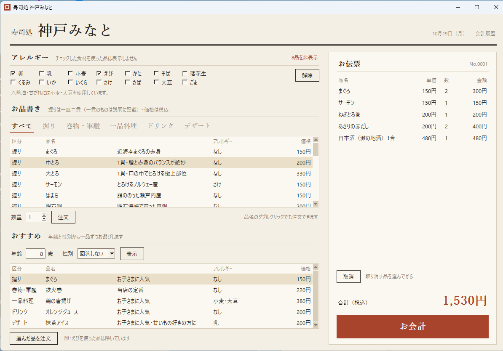
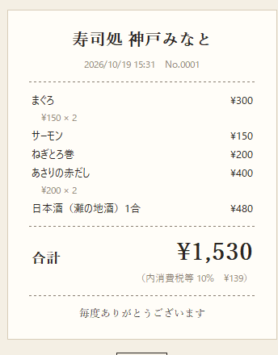
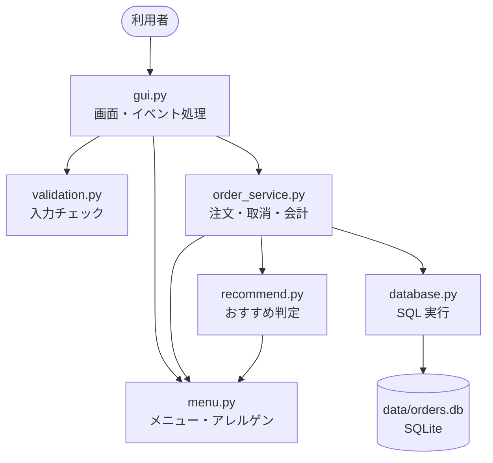
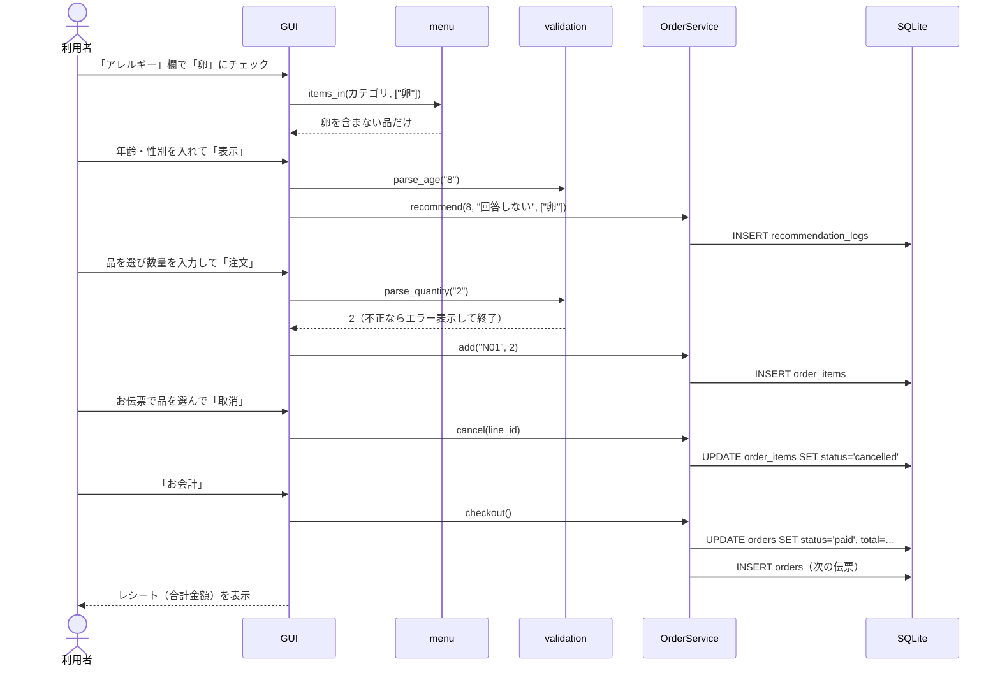
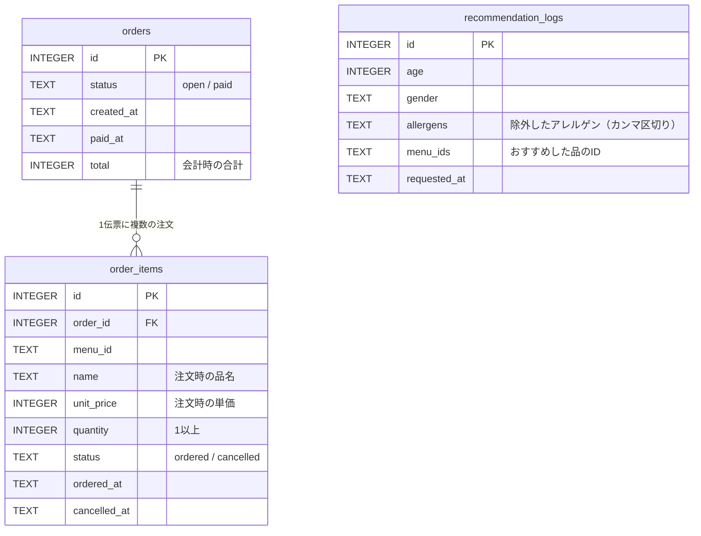
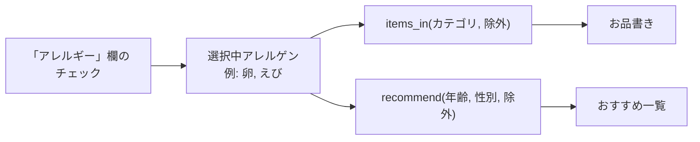

# 寿司処 神戸みなと — メニュー・オーダーシステム

寿司店向けの、メニュー表示・注文・会計を行うデスクトップアプリです。アレルギーで品を絞り込めます。
Python の標準ライブラリ（tkinter / sqlite3）だけで動くので、**追加のインストールは不要**です。



---

## 1. 起動方法

### 動作環境

| 項目 | 内容 |
|---|---|
| Python | 3.9 以上（3.14 で動作確認済み） |
| OS | Windows / macOS / Linux |
| 外部ライブラリ | なし（tkinter, sqlite3 は Python に同梱） |

### 手順

```bash
git clone https://github.com/daiichi001/innsyokuorder.git
cd innsyokuorder
python main.py
```

- macOS / Linux で `python` が無い場合は `python3 main.py` を使ってください。
- Linux で `No module named '_tkinter'` と出る場合は tkinter を追加してください（例: `sudo apt install python3-tk`）。
- 初回起動時に `data/orders.db`（注文データ）が自動で作られます。初期化したいときはこのファイルを削除してください。

### テストの実行（任意）

```bash
python -m unittest -v
```

---

## 2. 使い方と要件の対応

| # | 要件 | 画面での確認方法 | 実装箇所 |
|---|---|---|---|
| 1 | 店名表示 | 起動すると画面上部とタイトルバーに「寿司処 神戸みなと」と表示されます。 | `config.py` / `gui.py` |
| 2 | メニュー表示（20品以上・カテゴリ切替・適正価格） | 全41品（握り14・巻物・軍艦6・一品料理7・ドリンク8・デザート6）。「お品書き」の上の「すべて／握り／巻物・軍艦／一品料理／ドリンク／デザート」をクリックして切り替えます。価格は税込で、回転寿司チェーンの相場に合わせています（握りは1皿2貫、とろ・うに・いくらは1貫）。 | `menu.py` |
| 3 | 注文（数量指定・会計前の取消） | 品を選び、数量（1〜99）を入れて「注文」を押します（品名のダブルクリックでも可）。取り消すときは、右の「お伝票」で行を選び（Ctrl/Shift で複数選択可）「取消」を押します。 | `order_service.py` |
| 4 | 注文データの記録 | 注文・取消・会計はすべて SQLite（`data/orders.db`）に記録されます。取り消した注文も削除せず「取消」状態で残ります。会計済みの伝票は、画面右上の「会計履歴」から一覧できます。 | `database.py` |
| 5 | おすすめ機能 | 「おすすめ」欄に年齢と性別を入れて「表示」を押すと、カテゴリごとに1品ずつ理由付きで表示されます。選んで「選んだ品を注文」で、そのまま注文もできます。 | `recommend.py` |
| 6 | 会計 | 「お会計」を押すと、明細と合計金額（税込・内消費税額つき）をレシートの形で表示します。会計後は新しい伝票に切り替わります。<br> | `gui.py` `ReceiptWindow` |
| 7 | 入力チェック | 年齢に `abc`、`-5`、`3.5`、空欄、`200` などを入れても止まらず、赤字でエラー内容を表示します。全角数字（`３５`）は受け付けます。数量も同様にチェックします。 | `validation.py` |
| 8 | アレルギー対応 | **表示**: お品書きとおすすめの「アレルギー」列に、各品のアレルゲンを表示します。<br>**除外**: 画面左上の「アレルギー」欄でチェックを付けると、その食材を使った品がお品書きからすぐに消えます（「N品を非表示」と表示）。<br>**おすすめ**: チェック中のアレルゲンを含む品はおすすめ候補からも外れます。おすすめ表示中にチェックを変えると、自動で選び直します。 | `menu.py` / `recommend.py` / `gui.py` |

---

## 3. 画面デザイン

寿司店の品書きと伝票をイメージしています。

| 要素 | 方針 |
|---|---|
| 配色 | 生成り（和紙 `#f4efe4`）の地に墨色（`#2b2622`）の文字。朱（`#a8432c`）は合計金額と「お会計」ボタンだけに使う |
| 書体 | 店名・見出し・金額は明朝（游明朝など）、一覧や説明はゴシック。見つからない環境では標準フォントで代用 |
| ヘッダー | 店名の下に品書きふうの二重線。右に日付と「会計履歴」 |
| 区分の切替 | 文字だけのタブ。選択中のタブは太字にして朱の下線を引く |
| お伝票 | 右側に伝票の形で表示。伝票番号、品名・単価・数・金額、合計（税込） |
| 会計 | レシートの形で表示（点線の区切り、内消費税額、「毎度ありがとうございます」） |
| アイコン | 標準の羽根アイコンの代わりに、朱の角印ふうのアイコン |

配色・書体は `restaurant/gui.py` 冒頭の定数と `_setup_style()` にまとめています。

---

## 4. システム構成

### ディレクトリ構成

```
innsyokuorder/
├── main.py                  # 起動スクリプト（DB接続 → 画面起動）
├── restaurant/
│   ├── config.py            # 店名・DBパス・入力範囲などの設定値
│   ├── menu.py              # メニューデータ（41品）・アレルゲン定義・絞り込み関数
│   ├── validation.py        # 年齢・数量の入力チェック
│   ├── recommend.py         # おすすめロジック（アレルゲン除外を含む）
│   ├── database.py          # SQLite のテーブル定義・マイグレーション・読み書き
│   ├── order_service.py     # 注文・取消・会計の業務ロジック
│   └── gui.py               # tkinter の画面
├── tests/                   # unittest による自動テスト（28件）
├── data/                    # orders.db が自動生成される（Git管理外）
└── docs/                    # README 用の画面画像
```

### レイヤー構成

画面（GUI）と業務ロジックを分けています。ロジックは画面なしでテストできます。



### 処理の流れ



---

## 5. データ設計

### 5.1 メニュー（`restaurant/menu.py`）

メニューは変更が少ないので、コード内の定数として持っています。

| 項目 | 型 | 説明 | 例 |
|---|---|---|---|
| id | str | メニューID（カテゴリの頭文字＋連番） | `N10` |
| name | str | 品名 | 玉子 |
| category | str | 握り / 巻物・軍艦 / 一品料理 / ドリンク / デザート | 握り |
| price | int | 税込価格（円） | 120 |
| description | str | 説明文（1貫の品は先頭に「1貫・」） | だしの効いた自家製厚焼き |
| allergens | frozenset | 含まれるアレルゲン（`ALLERGENS` の名前のみ） | `{"卵", "大豆"}` |
| tags | frozenset | おすすめ判定用タグ | `{"kids", "sweet", "senior"}` |

### 5.2 アレルゲン

| 区分 | 品目 |
|---|---|
| 特定原材料（表示義務8品目） | 卵・乳・小麦・えび・かに・そば・落花生・くるみ |
| 推奨表示品目のうち寿司店で関係が深いもの | いか・いくら・さけ・さば・大豆・ごま |

- 定義にないアレルゲン名をメニューに書くと、起動時に `assert` で止まります（入力ミス防止）。
- 卓上の醤油・甘だれには小麦・大豆が含まれます。画面にも注意書きを出しています。

<details>
<summary>メニュー一覧（41品・アレルゲン付き）</summary>

| ID | 品名 | カテゴリ | 量 | 価格 | アレルギー |
|---|---|---|---|---|---|
| N01 | まぐろ | 握り | 2貫 | ¥150 | なし |
| N02 | 中とろ | 握り | 1貫 | ¥200 | なし |
| N03 | 大とろ | 握り | 1貫 | ¥330 | なし |
| N04 | サーモン | 握り | 2貫 | ¥150 | さけ |
| N05 | はまち | 握り | 2貫 | ¥150 | なし |
| N06 | 明石鯛 | 握り | 2貫 | ¥200 | なし |
| N07 | えび | 握り | 2貫 | ¥130 | えび |
| N08 | いか | 握り | 2貫 | ¥130 | いか |
| N09 | うに | 握り | 1貫 | ¥300 | なし |
| N10 | 玉子 | 握り | 2貫 | ¥120 | 卵・大豆 |
| N11 | 煮穴子 | 握り | 2貫 | ¥220 | 小麦・大豆 |
| N12 | しめさば | 握り | 2貫 | ¥150 | さば |
| N13 | ずわいがに | 握り | 2貫 | ¥280 | かに |
| N14 | お子さま寿司セット | 握り |  | ¥550 | 卵・小麦・えび・さけ・大豆 |
| K01 | 鉄火巻 | 巻物・軍艦 |  | ¥220 | なし |
| K02 | かっぱ巻 | 巻物・軍艦 |  | ¥130 | ごま |
| K03 | ねぎとろ巻 | 巻物・軍艦 |  | ¥200 | なし |
| K04 | いくら軍艦 | 巻物・軍艦 | 1貫 | ¥360 | 小麦・いくら・大豆 |
| K05 | カリフォルニアロール | 巻物・軍艦 |  | ¥260 | 卵・小麦・かに・大豆・ごま |
| K06 | サラダ軍艦 | 巻物・軍艦 |  | ¥120 | 卵・小麦・かに・大豆 |
| I01 | 茶碗蒸し | 一品料理 |  | ¥260 | 卵・小麦・えび・大豆 |
| I02 | えび天ぷら | 一品料理 |  | ¥400 | 卵・小麦・えび・大豆 |
| I03 | 鶏の唐揚げ | 一品料理 |  | ¥380 | 小麦・大豆 |
| I04 | 枝豆 | 一品料理 |  | ¥200 | 大豆 |
| I05 | あさりの赤だし | 一品料理 |  | ¥200 | 大豆 |
| I06 | 天ざるそば | 一品料理 |  | ¥550 | 卵・小麦・えび・そば・大豆 |
| I07 | いんげんのピーナッツ和え | 一品料理 |  | ¥200 | 落花生・大豆 |
| D01 | オレンジジュース | ドリンク |  | ¥200 | なし |
| D02 | ウーロン茶 | ドリンク |  | ¥200 | なし |
| D03 | コーラ | ドリンク |  | ¥220 | なし |
| D04 | ラムネ | ドリンク |  | ¥200 | なし |
| D05 | 生ビール | ドリンク |  | ¥550 | なし |
| D06 | 日本酒（灘の地酒）1合 | ドリンク |  | ¥480 | なし |
| D07 | レモンサワー | ドリンク |  | ¥420 | なし |
| D08 | 抹茶ラテ | ドリンク |  | ¥280 | 乳 |
| S01 | 抹茶アイス | デザート |  | ¥200 | 乳 |
| S02 | わらびもち | デザート |  | ¥200 | 大豆 |
| S03 | 杏仁豆腐 | デザート |  | ¥200 | 乳 |
| S04 | 黒ごまプリン | デザート |  | ¥250 | 乳・ごま |
| S05 | 季節のフルーツ盛り | デザート |  | ¥330 | なし |
| S06 | くるみ餅 | デザート |  | ¥220 | くるみ・大豆 |

</details>

### 5.3 価格の決め方

大手回転寿司チェーンの2026年の価格を調べ、それと同じくらいの価格帯にしています（すべて税込）。

| 区分 | 調べた価格 | 本アプリの価格 |
|---|---|---|
| 定番ネタ（まぐろ・サーモンなど） | くら寿司は最低110円、サーモンなど33品は120円（2026年9月改定） | 120〜150円（2貫） |
| 中とろ・うに | スシローの通常価格は180円〜 | 中とろ200円・うに300円（1貫） |
| いくら | スシロー「北海道産 上いくら」360円〜 | 360円（1貫） |
| 大とろ | スシローのフェア価格は110円〜（期間限定） | 330円（1貫。フェアではない通常の値段として設定） |
| 茶碗蒸し・唐揚げ | スシローは茶碗蒸し240円（掲載時期は不明）、唐揚げ360円〜 | 茶碗蒸し260円・唐揚げ380円 |
| ドリンク・デザート | チェーンの公式価格は見つからなかった | ソフトドリンク200円前後、生ビール550円、デザート200〜330円（推定） |

参考にした記事:
- [くら寿司 価格改定のお知らせ（北海道新聞）](https://www.hokkaido-np.co.jp/article/1355650/)
- [スシロー 中とろ・うにが180→110円になる「すし初め」（livedoor ニュース）](https://news.livedoor.com/article/detail/30338958/)
- [スシロー 110円の大とろ・上いくらなど夏の新メニュー（グルメ Watch）](https://gourmet.watch.impress.co.jp/docs/news/2129664.html)

価格は時期や店舗で変わります。ここに載せた数字は2026年10月に調べたものです。

### 5.4 注文データ（SQLite: `data/orders.db`）



| テーブル | 役割 |
|---|---|
| `orders` | 伝票（1組のお客さま分）。`open` = 会計前、`paid` = 会計済み。 |
| `order_items` | 注文明細。注文のたびに1行追加します。取消は削除せず `status='cancelled'` にして記録を残します。 |
| `recommendation_logs` | おすすめ機能の利用記録（年齢・性別・除外アレルゲン・提示した品）。 |

設計上のポイント:

- 明細には**注文時点の品名・単価をコピー**して保存します。あとでメニューの価格を変えても、過去の注文金額は変わりません。
- 取消は論理削除にしているので、「何をいつ取り消したか」を後から確認できます。
- 会計せずにアプリを終了しても、次回起動時に `open` の伝票を引き継ぎます。
- `paid` の伝票に属する明細は取り消せません（会計後の取消を防止）。
- アレルギー対応より前に作った DB でも、起動時に `allergens` 列を自動で追加します（`Database._migrate`）。

データを直接見たい場合の例:

```bash
python -c "import sqlite3; c=sqlite3.connect('data/orders.db'); [print(tuple(r)) for r in c.execute('SELECT * FROM order_items')]"
```

---

## 6. アレルギー除外の仕組み



- 除外の判定は「品の `allergens` と選択中アレルゲンに**1つでも共通するものがあれば除外**」です（`MenuItem.contains_any`）。
- お品書きとおすすめは同じ `items_in()` で絞り込むので、両方の結果は必ず一致します。
- たとえば卵アレルギーの8歳の場合、通常のおすすめ「お子さま寿司セット（卵を含む）」の代わりに「まぐろ」を提案します。
- 除外の結果、あるカテゴリに候補が1品も残らなければ、そのカテゴリはおすすめに表示しません。

---

## 7. おすすめロジック

年齢層と性別から「タグごとの点数」を決めます。候補の各品について、持っているタグの点数を合計し、**カテゴリごとに最高点の1品**を選びます（同点ならメニュー順で先の品）。

| 年齢層 | 加点するタグ |
|---|---|
| 0〜12歳 | お子さまに人気 +3、お子さま限定 +2、甘いもの +1 |
| 13〜19歳 | 10代に人気 +3、食べごたえ +1、みんなでつまめる +1 |
| 20〜39歳 | 食べごたえ +2、お酒 +2、お酒のおとも +1、みんなでつまめる +1 |
| 40〜59歳 | ヘルシー +2、お酒のおとも +2、お酒 +1、あっさり +1、高級ネタ +1 |
| 60歳以上 | やさしい味わい +3、ヘルシー +1、あっさり +1、高級ネタ +1 |

| 性別 | 追加の加点 |
|---|---|
| 男性 | 食べごたえ +1、高たんぱく +1 |
| 女性 | ヘルシー +1、甘いもの +1 |
| その他 / 回答しない | なし（年齢のみで判定） |

候補から外すもの:
- **選択中のアレルゲンを含む品**
- **20歳未満へのアルコール**
- 13歳以上へのお子さま寿司セット

おすすめ理由は、点数に寄与したタグのうち上位2つから作ります（例:「やさしい味わい・ヘルシー」）。

---

## 8. 入力チェック

`validation.py` が年齢と数量を検証し、不正な場合は `ValidationError` を投げます。画面側はそれを受け取ってメッセージを表示するだけなので、アプリは停止しません。

| 入力例 | 結果 |
|---|---|
| `25`, ` 25 `, `２５` | OK（前後の空白・全角数字を許容） |
| 空欄 | 「年齢を入力してください。」 |
| `abc`, `二十`, `3.5`, `20歳` | 「年齢は整数（半角または全角の数字）で入力してください。」 |
| `-5` | 「年齢に負の値は入力できません。」 |
| `121` 以上 | 「年齢は 0〜120 の範囲で入力してください。」 |

アレルギーはチェックボックス、性別は選択式のため、不正な値は入力できません。
さらに、画面で想定外の例外が起きてもエラーダイアログを出して処理を続けます（`gui.py` の `report_callback_exception`）。

---

## 9. テスト

`tests/` に28件の自動テストがあります（`python -m unittest -v`）。

| ファイル | 内容 |
|---|---|
| `test_validation.py` | 年齢・数量の正常値／異常値（文字・負の値・小数・範囲外・全角） |
| `test_menu_and_recommend.py` | 20品以上・ID重複なし・カテゴリ絞り込み・アレルゲン表示と除外（単数・複数・カテゴリ併用）・おすすめからの除外・未成年に酒を出さない |
| `test_order_service.py` | 数量指定の注文・取消・会計後の取消不可・会計記録・伝票の引き継ぎ・おすすめ記録・旧DBのマイグレーション |
